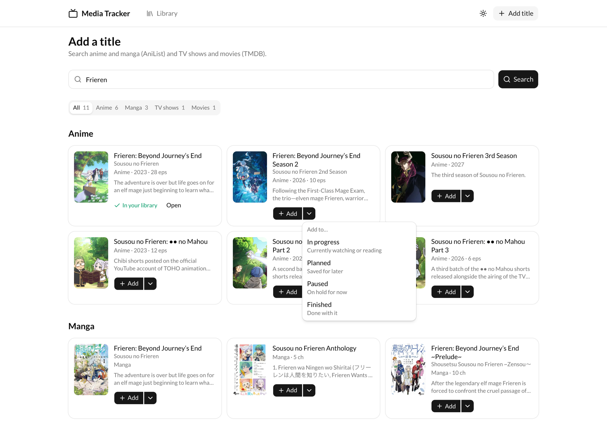
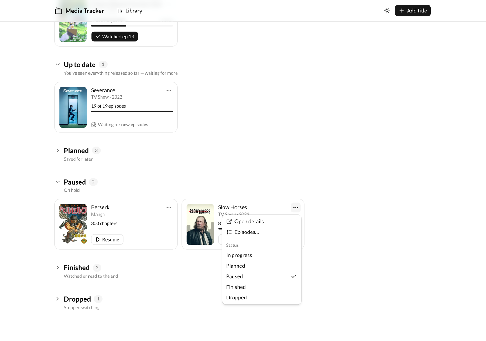
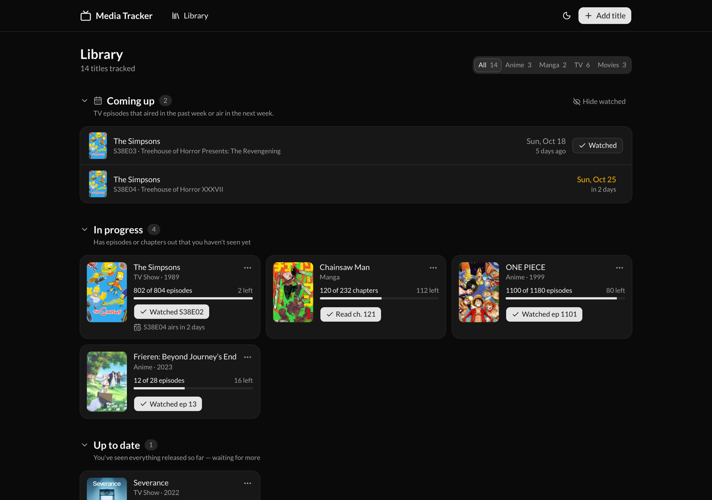
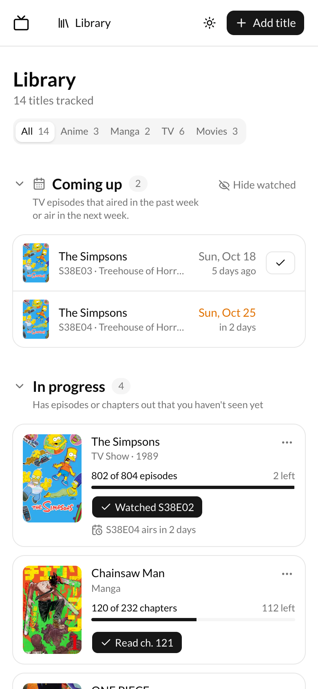

# Media Tracker

A personal, self-hosted tracker for **anime, manga, TV shows and movies**. Add the things you're watching or reading, tick off episodes as you go, and see what's out next, all in one library.

It's a single-user web app you run yourself, on your own computer or a free hosting account. There are no accounts, ads or tracking. Your library lives in your own Postgres database.


## Contents

- [What it does](#what-it-does)
- [A quick tour](#a-quick-tour)
- [How your library is organised](#how-your-library-is-organised)
- [Setting it up](#setting-it-up)
- [Deploying it online](#deploying-it-online)
- [Where the data comes from](#where-the-data-comes-from)
- [Troubleshooting](#troubleshooting)
- [For developers](#for-developers)

## What it does

- **One library for everything.** Search across anime, manga, TV shows and movies in one go, and add any of them with one click.
- **Progress in one tap.** Every card has a button for the next step, such as "Watched S02E03", "Read ch. 121" or "Mark watched". Each change can be undone.
- **Knows what's out.** It compares your progress with what has actually been released, so a show you're up to date on moves out of the way until a new episode airs.
- **Upcoming episodes.** A "Coming up" list shows TV episodes that aired in the last week or air in the next week.
- **Episode lists.** Browse every episode with titles, air dates and summaries, plus filler and recap tags for anime, and mark everything up to a given episode as watched.
- **Light and dark mode**, and it works on phones.

## A quick tour

### 1. Add a title

Click **Add title** in the top-right corner, type a name and press Enter. The app searches anime, manga, TV shows and movies at the same time and groups the results by type. The best match comes first.


**Add** puts the title in your library as *In progress*. To add it somewhere else, for example *Planned* for something you want to watch later, open the small arrow next to **Add**. Titles you already track say **In your library** instead.



### 2. Track your progress

On the **Library** page, each card shows how far you are, for example "8 of 36 episodes · 28 left", and one button for the obvious next step:

| On a card in… | The button says | What it does |
| --- | --- | --- |
| In progress | **Watched S02E03** or **Read ch. 121** | Marks the next episode or chapter as done |
| Planned | **Start watching** | Moves it to In progress |
| Paused | **Resume** | Moves it to In progress |
| Any movie | **Mark watched** | Marks the movie as finished |

After each change a message appears in the corner with an **Undo** button.

Everything else is in the **⋯** menu on each card: open the details page, open the **Episodes…** list, or change the status. For manga, **Where I'm up to…** sets the last chapter you read.



> [!TIP]
> Setting something to **Finished** marks every released episode or chapter as watched for you.

### 3. Episodes

**Episodes** opens every episode of a show, starting at the one you're on, which is marked **You're here**. TV shows have a tab for each season, or a dropdown for long-running shows.

- **Tap an episode** to mark it and everything before it as watched. This is the quickest way to catch up after watching several episodes elsewhere, with no counting needed. Tapping an earlier episode moves your progress back.
- **Tap ⌄** at the end of a row to read the episode's summary.
- **I haven't started** at the bottom clears your progress.

Watched episodes have a green tick, and anime episodes are tagged **Filler** or **Recap** where that applies. For manga, which has no episode list, use **Change chapter** and enter the last chapter you read.


### 4. The details page

Click any title to open its page. The progress panel leads with what's **up next**, for example "S38E02 · Diary of a Chimpy Kid", with a **Mark watched** button and an **Episodes** button that opens the episode list. Next to it are the status, a 1–10 rating and private notes. Notes save when you click away.

To refresh a title's details from its source, or to remove it, use the **⋯** menu in the top-right corner of the page. Removing a title asks you to confirm first.


### Dark mode and phones

Use the sun or moon button in the header to choose **Light**, **Dark** or **System** (follow your device). The layout adapts to phone screens.

<p>
  
  
</p>

## How your library is organised

The Library page groups titles into sections. Some sections hold the status you chose; others the app works out from your progress.

| Section | What's in it |
| --- | --- |
| **Coming up** | TV episodes that aired in the past week or air in the next week. Shown only when there are any. |
| **In progress** | Things you're watching or reading that have episodes or chapters out that you haven't seen yet. |
| **Up to date** | Things you're watching where you've seen everything released so far, and more is on the way. |
| **Planned** | Saved for later. |
| **Paused** | On hold. |
| **Finished** | Watched or read to the end. |
| **Dropped** | Stopped and not coming back. |

You never choose **Up to date** yourself. Anything set to **In progress** moves there automatically once you've caught up, and moves back when a new episode comes out. If you catch up on a series that has ended, it moves to **Finished**.

Sections can be folded away by clicking their heading. Planned, Paused, Finished and Dropped start folded, and the app remembers your choice. Use the **All / Anime / Manga / TV / Movies** filter at the top to show just one kind.

## Setting it up

You'll need about 15 minutes. You don't need to know how to program, but you will paste a few commands into a terminal.

### What you need

1. **Node.js 20.19 or newer** (22 or 24 also work). Download the "LTS" version from [nodejs.org](https://nodejs.org). To check what you have, run `node --version` in a terminal.
2. **A Postgres database.** The easiest option is a free hosted one: create a project on [Neon](https://neon.tech) or [Supabase](https://supabase.com) and copy its *connection string*, which starts with `postgresql://`. A Postgres install on your own computer works too.
3. **A free TMDB API key**, for TV shows and movies:
   1. Create an account at [themoviedb.org](https://www.themoviedb.org/signup).
   2. Go to **Settings → API** ([direct link](https://www.themoviedb.org/settings/api)) and request a key for personal use.
   3. Copy the **API Key** (the short one, labelled "v3 auth"), not the long "Read Access Token".

Anime and manga come from AniList and Tenrai, which don't need keys.

### Install and run

1. Download the code and install it. Installing also prepares the database client.

   ```bash
   git clone https://github.com/tahir606/Tracker.git
   cd Tracker
   npm install
   ```

2. Create your settings file:

   ```bash
   cp .env.example .env
   ```

   Open `.env` in any text editor and fill in the two values:

   ```bash
   DATABASE_URL="postgresql://..."   # your database connection string
   TMDB_API_KEY="..."                # your TMDB v3 API key
   ```

3. Create the database tables:

   ```bash
   npm run migrate:dev
   ```

   It should finish with "Your database is now in sync with your schema."

4. Start the app:

   ```bash
   npm run dev
   ```

   Open [http://localhost:3000](http://localhost:3000). You'll see an empty library with an **Add your first title** button. Start there.

To stop the app, press `Ctrl + C` in the terminal. Run `npm run dev` again whenever you want to use it.

## Deploying it online

The app runs anywhere Next.js runs: [Vercel](https://vercel.com) (free tier), a VPS, or Docker.

1. Create the tables in your production database by putting its connection string in a `.env.production` file and running:

   ```bash
   npm run migrate:prod
   ```

2. Set `DATABASE_URL` and `TMDB_API_KEY` as environment variables on your host.
3. Deploy. On Vercel, you can use the [Vercel CLI](https://vercel.com/docs/cli) (`npx vercel deploy --prod`) or connect the GitHub repository in the Vercel dashboard.

> [!WARNING]
> There is **no login**. Anyone who can open the app's URL can see and change your library. Keep it on your own computer, or put it behind access protection, for example [Vercel Deployment Protection](https://vercel.com/docs/security/deployment-protection), Cloudflare Access, or HTTP basic auth on a reverse proxy.

## Where the data comes from

| What | Source | Key needed? |
| --- | --- | --- |
| Anime and manga search, details and airing schedule | [AniList](https://anilist.co) | No |
| Anime episode titles, summaries, and filler and recap tags (MyAnimeList data) | [Tenrai](https://tenrai.org), a Jikan-compatible API | No |
| TV shows and movies, seasons and episode schedules | [TMDB](https://www.themoviedb.org) | Yes, free |

All dates are the original air dates. If Tenrai can't be reached, anime episode lists fall back to AniList automatically; titles and filler tags may be missing until it's back, and the episode list shows a note when that happens.

This product uses the TMDB API but is not endorsed or certified by TMDB.

## Troubleshooting

**`npm run migrate:dev` fails with a connection error.**
Check `DATABASE_URL` in `.env`. Hosted databases often need `?sslmode=require` at the end of the connection string. Copy the full string from your provider's dashboard.

**TV shows and movies don't appear in search, but anime does.**
`TMDB_API_KEY` is missing or wrong. Use the v3 "API Key", not the "Read Access Token". Restart `npm run dev` after editing `.env`.

**An episode count or status looks out of date.**
Details are saved when you add a title. Open the title, then choose **⋯ → Update details from…** to refresh them. TV schedules on the Library page are always fetched live.

**Port 3000 is already in use.**
Run `npm run dev -- -p 3001` and open [http://localhost:3001](http://localhost:3001).

## For developers

Built with Next.js 16 (App Router), React 19, TypeScript, Tailwind CSS 4, shadcn/Base UI, and Postgres via Prisma 7.

| Command | What it does |
| --- | --- |
| `npm run dev` | Start the dev server |
| `npm run build` | Generate the Prisma client and build for production |
| `npm run start` | Run the production build |
| `npm run lint` | Run ESLint |
| `npm run migrate:dev` | Apply migrations to the database in `.env` |
| `npm run migrate:prod` | Apply migrations using `.env.production` |

Where things live:

- `src/app/`: pages and API routes. Pages are server components; interactive parts live in `*-client.tsx` components.
- `src/components/media/`: the app's feature components (cards, dialogs, sections).
- `src/lib/`: provider clients (`anilist.ts`, `tmdb.ts`, `jikan.ts` for Tenrai) and the logic that decides each title's section (`library-section.ts`).
- `prisma/schema.prisma`: two tables. `Media` holds a title's details, and `Tracking` holds your progress, status, rating and notes.

Issues and pull requests are welcome. Please run `npm run lint` before opening a PR.

## License

[MIT](LICENSE)
